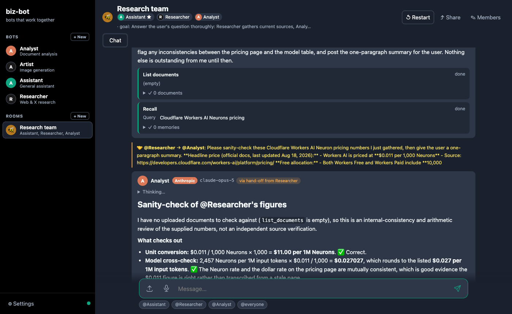

# biz-bot (created by Greg DeCarlo - @mrinreality1 on X)

Customizable **bots** stored in your browser, powered by the latest **OpenAI GPT**, **xAI Grok** and **Anthropic Claude** models — that talk to each other and work together in **rooms** on your request. A static single-page app (no framework, no build step) served by a small **Cloudflare Worker** that holds the API keys and routes, configures and streams all model traffic.



> v2 renames "GPTs" to **bots** and adds: provider/model choice per bot, xAI voice/image/search, Claude, MCP servers, persistent vector search, memory, skills, and **rooms** — group chats of bots that hand work to each other, modelled on xAI's Grok Bot.

### Key features
- **Three providers, one UI.** Each bot picks a provider and model: OpenAI GPT‑5.6 (Sol/Terra/Luna), GPT‑5.5/5.4/5.2/5.1, GPT‑4.1; xAI Grok 4.6/4.5/4.3, Grok 4.20 (reasoning, non‑reasoning, **multi‑agent**), Grok Build; Anthropic Claude Opus 5, Sonnet 5, Haiku 4.5, Fable 5, Opus 4.8, Sonnet 4.6. Reasoning effort is configurable where supported; reasoning summaries stream into a collapsible "Thinking…" block.
- **Rooms.** A group chat of 2–6 bots with a shared goal. Address bots with `@Name` (or `@everyone`); unaddressed messages go to the room's coordinator or an automatic router. Bots delegate synchronously (`ask_bot`) or hand work off asynchronously (`message_bot`); hand‑offs are shown in the transcript and the receiving bot wakes up and continues — you never have to relay.
- **Tools per bot** (function calling on every provider):
  - Web search (native OpenAI / xAI / Claude search tools with citations, or the worker's `/api/search`), **X search** (xAI)
  - **Image generation** (xAI Grok Imagine Image 2.0, OpenAI gpt‑image‑2); image understanding on all vision models
  - **Text‑to‑speech** (xAI Grok voices — Eve, Ara, Rex, Sal…; OpenAI gpt‑4o‑mini‑tts) and **speech‑to‑text** (xAI STT / OpenAI gpt‑transcribe, or the browser's recognizer)
  - **Realtime voice** conversation with a bot (xAI Grok voice, beta)
  - **Documents:** drop in PDFs/text files → chunked, embedded (OpenAI or Workers AI) and stored locally (IndexedDB) → `search_documents` (vector search), `read_document` / summarise
  - **MCP servers:** add any remote MCP server (Streamable HTTP) in Settings; its tools are discovered live and offered to bots that enable it, optionally behind an *Allow / Deny* approval card
  - **Memory** (per‑bot and shared facts), **skills** (reusable instruction blocks, `/skill-name` in chat), provider‑hosted **code execution**
- **Privacy model unchanged:** bots, rooms, memory and vectors live only in your browser. The worker holds the provider keys as secrets, forwards requests and streams responses — it stores nothing. There is no client-side key entry.
- Share a bot, a conversation or a whole room (with its member bots) as a URL.
- Works in Chrome, Safari and iOS Safari (tested in WebKit with an iPhone viewport).

## Architecture
```
public/                static SPA (index.html, styles.css, js/*.js, _headers) — served by the worker
worker/src/index.js    Cloudflare Worker: /api/* router, origin policy, request limits
worker/src/providers/  openai.js (Responses API), xai.js (Responses API + tts/stt/images/realtime),
                       anthropic.js (Messages API), responses.js (shared parser), mock.js (keyless demo)
worker/src/mcp.js      MCP client (Streamable HTTP; JSON or SSE replies; protocol negotiation)
wrangler.jsonc         one deploy = worker + static assets; /api/* runs the worker first
scripts/               stamp.mjs (version), verify-live.mjs (live provider checks), e2e.mjs (browser tests)
```
The worker exposes a small **unified API** — `POST /api/chat` streams `{type:'text'|'reasoning'|'tool_call'|'citation'|'image'|'usage'|'done'|'error'}` events regardless of provider; plus `/api/image`, `/api/image/edit`, `/api/speech`, `/api/transcribe`, `/api/embeddings`, `/api/search`, `/api/mcp/tools`, `/api/mcp/call`, `/api/realtime/token`, `/api/models`, `/api/health`. The SPA runs each bot turn as a tool loop (model → tool calls executed in the browser → results → model), and the room engine (`public/js/swarm.js`) layers routing, hand‑offs and delegation on top.

## Setup (Cloudflare)
1. **Install & configure**
   ```bash
   npm install
   cp .dev.vars.example .dev.vars   # add OPENAI_API_KEY / XAI_API_KEY / ANTHROPIC_API_KEY (any subset)
   ```
   `ENABLE_MOCK=true` in `.dev.vars` adds a keyless "Mock" provider so you can try the UI, tool loop and rooms without any keys.
2. **Run locally** — the app and the API at http://localhost:8787
   ```bash
   npx wrangler login    # once — document embeddings use Workers AI (a remote binding), even in local dev
   npm run dev
   ```
3. **Deploy** (worker + SPA together; `npm run deploy` stamps the build version and runs the unit tests first)
   ```bash
   npx wrangler login
   npx wrangler secret put OPENAI_API_KEY      # repeat for XAI_API_KEY, ANTHROPIC_API_KEY
   npm run deploy
   ```
4. **Protect it.** Anyone who can reach the worker can spend your API credits, so put **Cloudflare Access** (Zero Trust → Applications) in front of the worker's `workers.dev` URL or custom domain. The API itself only accepts same‑origin requests (no wildcard CORS); to allow another site, list it in `ALLOWED_ORIGIN` in `wrangler.jsonc`.
5. **CI (optional).** `.github/workflows/deploy-worker.yml` runs the unit + browser tests on every push/PR and deploys on `main` when the `CLOUDFLARE_API_TOKEN` and `CLOUDFLARE_ACCOUNT_ID` repository secrets exist. Provider keys are never read from GitHub — they are worker secrets.

## Using bots and rooms
- **Bots** — *+ New* in the sidebar → name, title, description (standing rules), avatar, welcome, instructions, provider, model, reasoning effort, voice, tools, MCP servers, skills, files. Duplicate/delete from the Configure tab.
- **Rooms** — *+ New* under Rooms → name, shared goal, 2–6 members, optional coordinator. In chat: `@Researcher find sources, @Analyst check them against the PDF` runs both; a bare question is routed. Bots can call `ask_bot`, `message_bot`, `list_bots`.
- **Files** — drop a PDF/text file onto the page (indexed for the current bot or room), attach files to a bot in Configure, or paste images to talk about them.
- **Voice** — the mic button uses the browser recognizer (or the worker's STT); the **Voice** button (when xAI is configured) starts a realtime spoken conversation.
- **Settings** — status, MCP servers (test → add), skills, memory, export/import.
- **Mock tips** — with the Mock provider, `!tool search_documents {"query":"…"}` or `!tool ask_bot {"bot":"Artist","task":"…"}` drive the tool loop.

## Testing
```bash
npm test               # unit tests: provider stream parsers, tool round-trips, MCP client, store, room helpers, tool loop
npm run e2e            # browser tests (Chrome + WebKit desktop + WebKit iPhone) against a mock-only local worker
npm run verify:live    # live checks per configured provider against `npm run dev` (chat, tools, JSON schema, vision,
                       # web/X search, images, TTS→STT, embeddings, realtime token) — costs a few cents
```
`npm run e2e` needs Playwright browsers once: `npx playwright install chromium webkit`.

## Notes on models & APIs (Aug 2026)
- OpenAI and xAI are called through their **Responses APIs** (Chat Completions is legacy on both); Anthropic through the **Messages API** with adaptive thinking, `web_search_20260209`, code execution and — for Opus 5 / Fable 5 — server‑side refusal fallbacks (`fallbacks: "default"`).
- xAI: `web_search`, `x_search`, `code_interpreter`, `image_generation` and remote `mcp` server tools; `/v1/tts`, `/v1/stt`, `/v1/images/generations|edits`, `/v1/realtime` (ephemeral client secrets). xAI (and Anthropic) have no embeddings API.
- **Document embeddings** come from OpenAI `text-embedding-3-small` when `OPENAI_API_KEY` is set, otherwise from **Cloudflare Workers AI** (`@cf/baai/bge-base-en-v1.5`, the `ai` binding in `wrangler.jsonc`, free tier — no key). PDF text is extracted in the browser with pdf.js; vectors are stored in IndexedDB tagged with the embedding model, so switching models simply re‑indexes on the next upload.
- Grok Bot parity: named bots with standing rules, group chats with @mentions, bot‑to‑bot hand‑offs, coordinator pattern, memory, skills, approvals, MCP. Extras Grok Bot lacks: sharing bots/rooms by URL, three model families, voice.

Contributions welcome · MIT License · Author: [Greg DeCarlo](https://linktr.ee/mrinreality)
